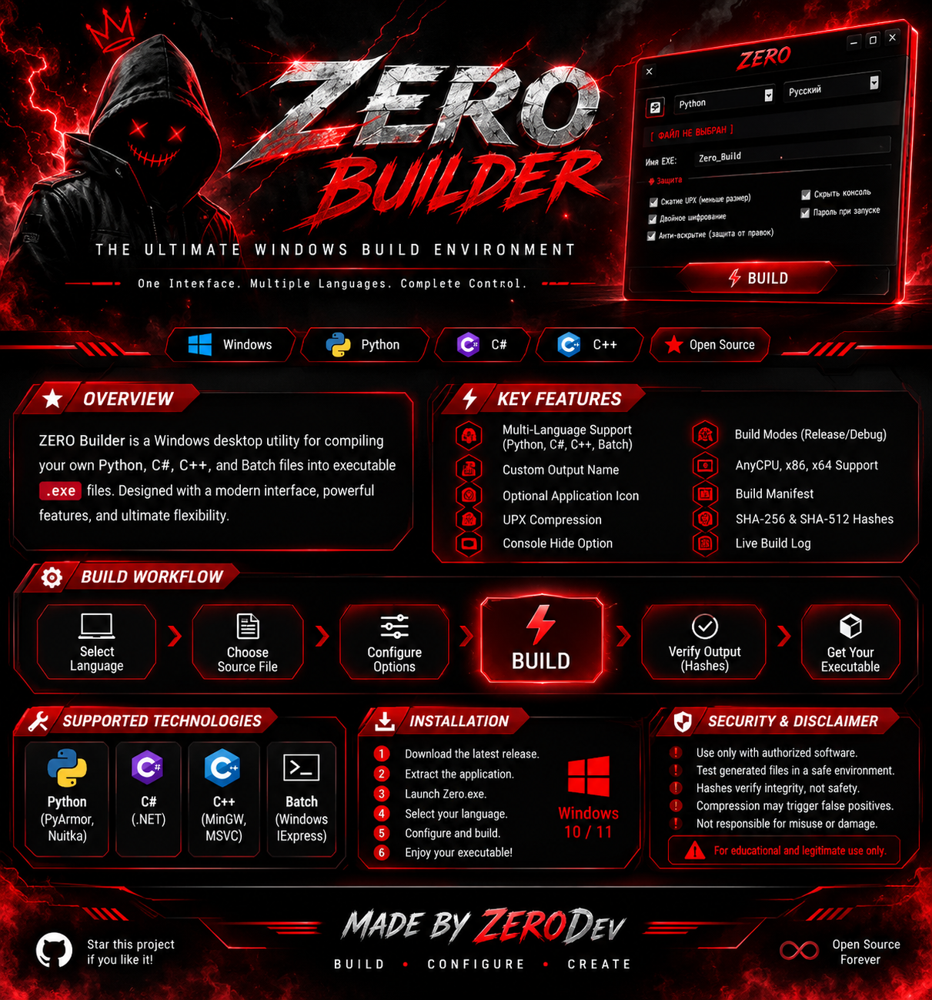
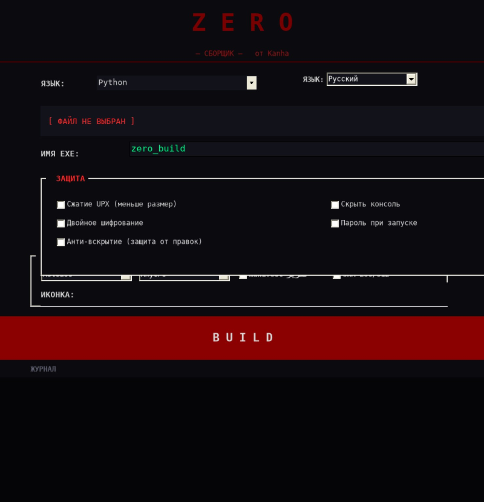
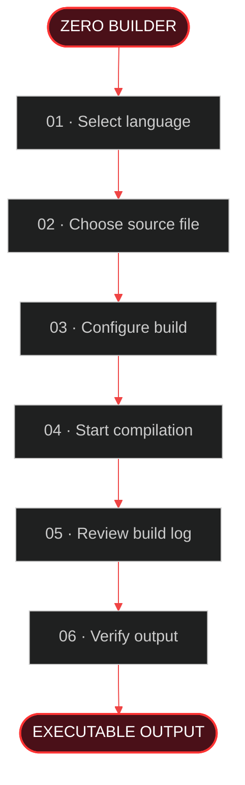

<div align="center">



<br>

<p>
  
  
  
  
  
</p>

<h3>ONE WORKSPACE. MULTIPLE LANGUAGES. CONTROLLED BUILDS.</h3>

<p>
  <a href="#-overview">OVERVIEW</a> &nbsp;·&nbsp;
  <a href="#-application-preview">PREVIEW</a> &nbsp;·&nbsp;
  <a href="#-features">FEATURES</a> &nbsp;·&nbsp;
  <a href="#-build-pipeline">BUILD PIPELINE</a> &nbsp;·&nbsp;
  <a href="#-getting-started">GETTING STARTED</a>
</p>

</div>

---

## ◈ OVERVIEW

**ZERO Builder** is a Windows desktop utility designed to bring supported source-to-executable build workflows into one interface.

Select a source language, choose your file, configure the available options, and monitor the build process from the integrated log.

> **ZERO BUILDER — BUILD · CONFIGURE · VERIFY**

---

## ◈ APPLICATION PREVIEW

<div align="center">



<sub>Actual application interface preview</sub>

</div>

---

## ◈ FEATURES

<table>
<tr>
<td width="50%" valign="top">

### ⚙️ MULTI-LANGUAGE WORKFLOW

- Python
- C#
- C++
- Windows Batch

</td>
<td width="50%" valign="top">

### 🎛️ BUILD CONFIGURATION

- Custom executable name
- Optional application icon
- Release / Debug where supported
- Architecture options where supported

</td>
</tr>
<tr>
<td width="50%" valign="top">

### 📦 OUTPUT OPTIONS

- Optional UPX compression
- Language-specific build tools
- Configurable output settings

</td>
<td width="50%" valign="top">

### 🔎 BUILD DIAGNOSTICS

- Integrated build log
- SHA-256 / SHA-512 hashes, when enabled
- Build output review

</td>
</tr>
</table>

*Feature availability depends on the selected language, application version, and installed toolchain.*

---

## ◈ BUILD PIPELINE



---

## ◈ SUPPORTED LANGUAGES & TOOLCHAINS

| LANGUAGE | POSSIBLE TOOLING |
|:--|:--|
| Python | Python, Nuitka, PyArmor — depending on configuration |
| C# | .NET / C# compiler |
| C++ | MinGW-w64 `g++` or Visual C++ `cl` |
| Batch | Windows batch packaging tools |

The actual tools and versions required depend on the implementation and selected build options.

---

## ◈ GETTING STARTED

### Requirements

- Windows 10 or Windows 11.
- The compiler, runtime, or packaging tools required by the selected language.
- Any additional dependencies required by the chosen build options.

### Quick start

1. Open the repository's **Releases** section.
2. Download the latest release, if one is published.
3. Extract the archive if necessary.
4. Launch `Zero.exe`.
5. Select the language and source file.
6. Choose an output name and configure available options.
7. Start the build.
8. Review the log and test the generated executable.

---

## ◈ OUTPUT INTEGRITY

When hash generation is enabled, ZERO Builder can provide SHA-256 and SHA-512 values for file-integrity checks.

```text
BUILD OUTPUT
    │
    ▼
GENERATE HASH
    │
    ▼
SAVE SHA-256 / SHA-512
    │
    ▼
COMPARE AFTER TRANSFER
```

**Important:** a matching hash can confirm that two files are identical. It does not prove that either file is safe.

---

## ◈ SECURITY & RESPONSIBLE USE

ZERO Builder is a compilation utility. It is **not** an antivirus, a digital-signing service, or a security certification tool.

- Only compile software you own or are authorized to build.
- Review source code and dependencies before compiling.
- Test unfamiliar executables in an isolated environment.
- Do not assume compression or packaging makes a file safe.
- Treat antivirus detections seriously and investigate them before running a file.

---

## ◈ TROUBLESHOOTING

<details>
<summary><b>Build tool not found</b></summary>

Install the compiler or runtime required for the selected language and confirm that ZERO Builder can locate it.

</details>

<details>
<summary><b>Compilation failed</b></summary>

Check the build log, source file, dependencies, compiler version, and selected architecture.

</details>

<details>
<summary><b>The generated EXE does not run on another PC</b></summary>

Check architecture compatibility, required runtimes, and external dependencies. An `.exe` is not automatically standalone.

</details>

<details>
<summary><b>Antivirus warning</b></summary>

Do not disable security protection just to run an unfamiliar executable. Review the source and build process, scan the output, and test it in an isolated environment.

</details>

---

<div align="center">

## ZERO BUILDER

### BUILD · CONFIGURE · VERIFY

**MADE BY ZERODev**

<sub>Created for legitimate development and authorized software builds.</sub>

</div>
