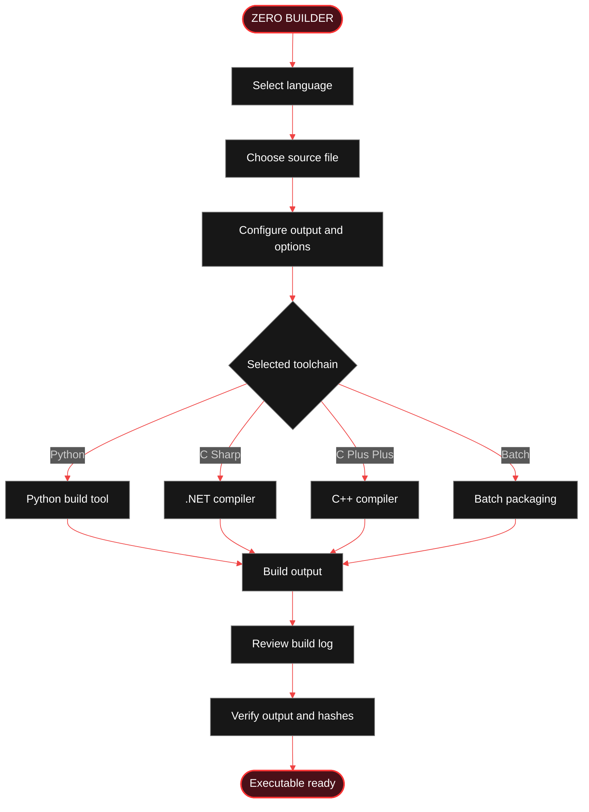
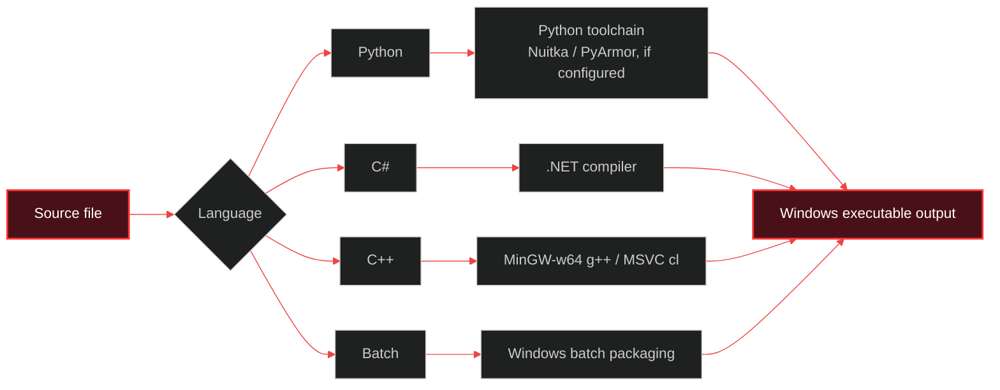
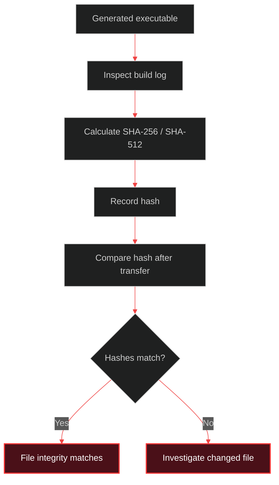

<h1>🔴 ZERO BUILDER</h1>

<h3>THE WINDOWS BUILD WORKSTATION</h3>

<b>ONE WORKSPACE · MULTIPLE LANGUAGES · CONTROLLED BUILDS</b>

  
  
  
  
  

  <b>BUILD.</b> &nbsp; <b>CONFIGURE.</b> &nbsp; <b>VERIFY.</b>

<i>A unified Windows desktop interface for turning supported source projects into executable builds.</i>

---

## ◈ 00 — PROJECT OVERVIEW

**ZERO Builder** is a Windows desktop utility for building supported **Python, C#, C++, and Batch** files into Windows executable (`.exe`) outputs.

It brings source selection, build configuration, compilation, and build logging into one interface.

> **Project philosophy:** clear controls, configurable builds, and visible build results.

---

## ◈ 01 — CAPABILITY MATRIX

| MODULE | CAPABILITY | DETAILS |
|:--|:--:|:--|
| Python | ● | Python build workflow |
| C# | ● | .NET compiler workflow |
| C++ | ● | MinGW-w64 or Visual C++ toolchain |
| Batch | ● | Windows batch packaging workflow |
| Output | ● | Custom executable name |
| Appearance | ● | Optional `.ico` application icon |
| Compression | ● | Optional UPX compression |
| Build modes | ● | Release / Debug, where supported |
| Architecture | ● | x86 / x64 / AnyCPU, where supported |
| Verification | ● | SHA-256 / SHA-512 hashes |
| Diagnostics | ● | Integrated build log |

---

## ◈ 02 — HOW THE BUILD FLOW WORKS

### Build lifecycle

| STAGE | ACTION |
|:--:|:--|
| `01` | Select a supported language |
| `02` | Load the source file |
| `03` | Set the output name and options |
| `04` | Run the selected build toolchain |
| `05` | Inspect the build log |
| `06` | Verify the generated output |

---

## ◈ 03 — BUILD OPTIONS

<b>▸ Output configuration</b>

- Set a custom executable filename.
- Select an optional application icon (`.ico`).
- Choose a build mode where supported.
- Select a target architecture where supported.

<b>▸ Compression and protection options</b>

- Optional UPX compression.
- Additional Python protection options may be available depending on the selected build workflow.
- Some options may change compatibility, file size, startup time, or antivirus detections.

<b>▸ Build verification</b>

- Review the integrated build log.
- Generate SHA-256 and SHA-512 hashes when enabled.
- Use hashes to compare file integrity; a matching hash does **not** prove that a file is safe.

---

## ◈ 04 — TOOLCHAIN MAP

**Tool availability depends on the selected language, installed dependencies, and the actual application configuration.**

---

## ◈ 05 — GETTING STARTED

### Requirements

- Windows 10 or Windows 11.
- The required compiler or runtime for the selected language.
- Additional build tools when the selected options require them.

### Quick start

1. Open the repository's **Releases** section.
2. Download the latest published Windows build, if one is available.
3. Extract the application if it is distributed in an archive.
4. Launch `Zero.exe`.
5. Select the source language and source file.
6. Configure the output and supported options.
7. Start the build and inspect the log.
8. Verify the generated executable before using or distributing it.

> Only download releases published by the project owner. If no release is available, check the repository's build instructions before attempting to compile the application yourself.

---

## ◈ 06 — OUTPUT VERIFICATION

A cryptographic hash can help detect accidental or unauthorized file changes. It does not identify malware, validate the source code, or certify an executable as safe.

---

## ◈ 07 — SECURITY & RESPONSIBLE USE

ZERO Builder is a compilation utility — **not** an antivirus, a digital-signing service, or a security certification product.

- Build only software you own or are authorized to compile.
- Review source code and dependencies before building.
- Test unfamiliar executables in an isolated environment.
- Treat unexpected antivirus detections seriously; do not assume every detection is a false positive.
- UPX compression and code-protection features can affect compatibility and may trigger security alerts.
- Never use generated executables to access systems or data without permission.

---

## ◈ 08 — TROUBLESHOOTING

<b>Build tool not found</b>

Install the compiler or runtime required by the selected language, then verify that the application can locate it.

<b>Build failed</b>

Read the build log from the first error. Check the source file, dependencies, compiler version, and selected architecture.

<b>Generated EXE is flagged by antivirus</b>

Do not disable security protection just to run an unfamiliar file. Review the source and build process, scan the output with reputable security tools, and test it in an isolated environment.

<b>Output does not run on another PC</b>

Check whether the target machine has the required runtime, architecture, and external dependencies. A generated `.exe` is not automatically dependency-free.

---

## ◈ 09 — PROJECT DETAILS

| FIELD | VALUE |
|:--|:--|
| Project | ZERO Builder |
| Platform | Windows |
| Interface | Desktop utility |
| Supported inputs | Python · C# · C++ · Batch |
| Main output | `.exe` |
| Documentation | `README.md` |

---

<h2>ZERO BUILDER</h2>

<h3>BUILD · CONFIGURE · VERIFY</h3>

<b>MADE BY ZERODev</b>

Designed for controlled, transparent, and authorized software builds.

