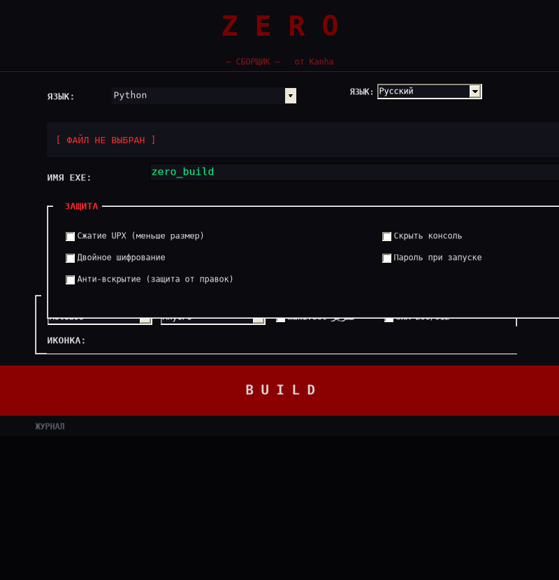

# ZERO Builder

ZERO Builder is a Windows desktop utility for building your own Python, C#, C++, and Batch files into executable `.exe` files.

## Download

Download the latest Windows executable from the **Releases** section of this repository:

```text
Zero.exe
```

No source code is required to run the release build. The application may require .NET Framework and the relevant compiler/runtime tools depending on the selected language.

## Interface preview



## Features

- Python, C#, C++, and Batch build modes.
- Custom output executable name.
- Optional application icon.
- Optional UPX compression.
- Optional console-window hiding for supported builds.
- Release and Debug build options.
- AnyCPU, x86, and x64 platform options.
- Optional build manifest.
- SHA-256 and SHA-512 output hashes.
- Live build log.

## Supported build tools

Depending on the selected language, the application may use:

- Python, PyArmor, and Nuitka.
- .NET Framework C# compiler.
- MinGW-w64 `g++` or Visual C++ `cl`.
- Windows IExpress for Batch builds.
- UPX, only when compression is enabled.

## Usage

1. Download `Zero.exe` from Releases.
2. Select the source language.
3. Select your source file.
4. Choose the output name and build options.
5. Optionally select an `.ico` file.
6. Press **BUILD**.
7. Check the build log and verify the generated hash when a manifest is enabled.

## Security and legal notice

Use ZERO Builder only with software you own or are authorized to build and distribute. This project is not an antivirus-bypass tool, digital-signing service, or security product. The hash output verifies file integrity but does not prove that a file is safe.

UPX compression and Python obfuscation may trigger antivirus false positives. Test every generated executable before distribution.

## Disclaimer

The author is not responsible for misuse of this software or for damage caused by executables created with it.
